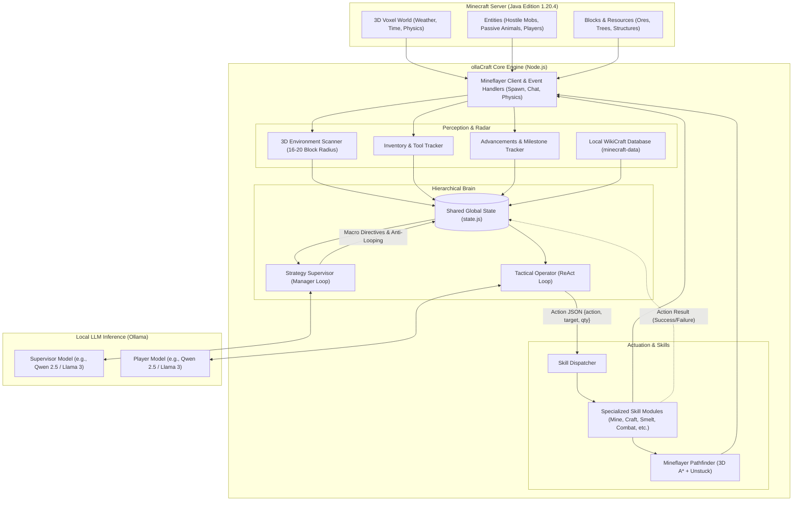
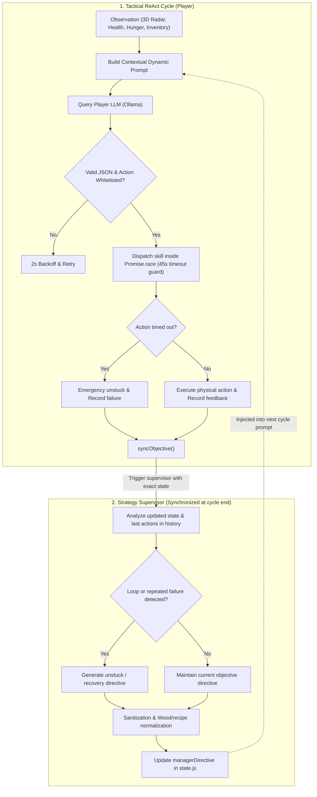
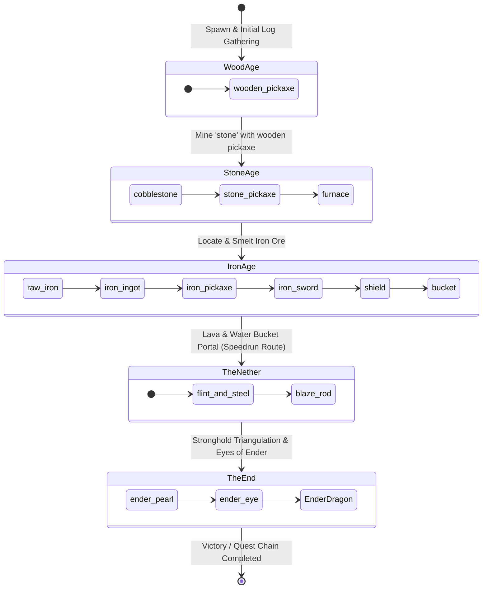

# 🗺️ Global System Architecture & Schematics - ollaCraft

**ollaCraft** is an autonomous survival agent for **Minecraft Java Edition** powered by local Large Language Models (LLMs) via **Ollama** and interfaced with the game through **Mineflayer**.

The architecture uses a two-tier hierarchical system (**Strategy Manager** + **Tactical ReAct Player**), backed by a deterministic skill engine and a 3D environment radar.

---

## 1. High-Level System Architecture

This diagram illustrates the separation of concerns across the Minecraft game server, the Node.js bot runtime, and the local LLM inference server.



---

## 2. Hierarchical Decision Loop: Strategy Manager vs Tactical ReAct Player

The agent separates macro-level strategy from micro-level reactivity with synchronized execution:

1. **Tactical ReAct Player** ([`src/ai/loop.js`](src/ai/loop.js)): Runs the **Perception &rarr; Prompt Construction &rarr; LLM Reasoning &rarr; Skill Dispatch (with 45s Timeout Guard) &rarr; Action Feedback** cycle.
2. **Strategy Manager** ([`src/ai/manager.js`](src/ai/manager.js)): Executed synchronously at the end of each Player thinking cycle, receiving the exact up-to-date state (eliminating blind timers and preventing idle token waste), reviewing recent actions, detecting loops or consecutive failures, updating macro directives, and sanitizing goals.



---

## 3. Sequence Diagram: Action Execution Cycle

This diagram details the sequence of calls during a single ReAct cycle:

```mermaid
sequenceDiagram
    autonumber
    participant Bot as Mineflayer Bot
    participant Loop as ReAct Loop (ai/loop.js)
    participant Prompt as Prompt Builder (ai/prompt.js)
    participant Ollama as Ollama API
    participant Dispatcher as Dispatcher (skills/dispatcher.js)
    participant Skill as Skill Module (e.g., mine.js)
    participant State as Global State (state.js)
    participant Manager as Supervisor Manager (ai/manager.js)

    Loop->>Bot: 3D Environment scan & inventory readout
    Loop->>State: syncObjective() (Check if current tier is completed)
    Loop->>Prompt: buildReactPrompt(bot, state, radar, craftingTable)
    Prompt-->>Loop: Assembled Prompt (Objective, Wiki Knowledge, Situation)
    Loop->>Ollama: POST /api/generate (Player Model)
    Ollama-->>Loop: JSON Response { thought, action, target, qty }
    Loop->>Bot: bot.chat("Action : action (target)")
    
    rect rgb(240, 248, 255)
        Note over Loop,Skill: 45s Timeout Guard (Promise.race)
        Loop->>Dispatcher: dispatchSkill(bot, state, action, target, qty)
        
        alt "mine" Action
            Dispatcher->>Skill: skillMine(bot, state, target, qty)
            Skill->>Bot: Equip best harvest tool & pathfinder to block
            Skill->>Bot: bot.dig(block)
            Skill-->>Dispatcher: { success: true, message: "Successfully mined" }
        else "craft" Action
            Dispatcher->>Skill: skillCraft(bot, state, target)
            Skill->>Skill: Wood & plank normalization (oak, jungle, birch, etc.)
            Skill->>Bot: Locate / place crafting table for 3x3 recipes
            Skill->>Bot: bot.craft(recipe)
            Skill-->>Dispatcher: { success: true, message: "Item crafted" }
        end
        Dispatcher-->>Loop: Action execution result
    end

    Loop->>State: Record into actionHistory & lastActionResult
    Loop->>State: syncObjective()
    
    rect rgb(255, 250, 240)
        Note over Loop,Manager: Synchronized Supervisor Cycle
        Loop->>Manager: runManagerCycle(bot) (Evaluate exact state)
        Manager->>Ollama: POST /api/generate (Supervisor Model)
        Manager->>State: Update managerDirective & managerSubGoal
    end

    Loop->>Loop: 1.5s delay, then trigger next cycle
```

---

## 4. Skills Matrix & Modular Capabilities

[`src/skills/dispatcher.js`](src/skills/dispatcher.js) routes validated action requests to dedicated, deterministic skill implementations:

| ReAct Action | Source Module | Functional Scope |
| :--- | :--- | :--- |
| `mine` | [`src/skills/mine.js`](src/skills/mine.js) | Scans for target blocks in 3D space, handles pathfinding, equips the optimal tool, and mines safely (prohibits digging straight down). |
| `craft` | [`src/skills/craft.js`](src/skills/craft.js) | Handles 2x2 player inventory recipes and 3x3 crafting table recipes (locates or automatically places a crafting table if missing). |
| `smelt` | [`src/skills/smelt.js`](src/skills/smelt.js) | Operates nearby furnaces, matches fuel sources (coal, logs, planks), and smelts raw ores into ingots. |
| `place` | [`src/skills/place.js`](src/skills/place.js) | Evaluates valid solid ground blocks (`VALID_GROUND_BLOCKS`) and places utility blocks (crafting tables, furnaces, chests). |
| `hunt` / `fight` | [`src/skills/combat.js`](src/skills/combat.js) | Selects the best weapon (swords/axes), engages targets with shield defense timing, attacks within melee range, and gathers drops. |
| `equip` | [`src/skills/equip.js`](src/skills/equip.js) | Evaluates and equips best armor upgrades and places the shield into the off-hand slot. |
| `chest` | [`src/skills/storage.js`](src/skills/storage.js) | Automates inventory dumping: navigates to the base chest and deposits bulky materials (dirt, cobblestone, gravel). |
| `eat` | [`src/skills/eat.js`](src/skills/eat.js) | Evaluates food items in inventory by saturation/nutrition value and consumes food proactively. |
| `unstuck` / `explore` | [`src/skills/navigate.js`](src/skills/navigate.js) | Failsafe routine (jump-scaffolding out of holes, escaping water) or safe perimeter exploration to uncover new resources. |
| `wiki` | [`src/skills/wiki.js`](src/skills/wiki.js) | Queries local game registries (`minecraft-data`) for recipes, harvest tools, and drop tables without LLM hallucination. |

---

## 5. State Machine: Survival Progression Chain

The agent advances through an ordered progression chain defined in [`QUEST_CHAIN`](src/config.js#L21-L43), dynamically evaluated against inventory counts:



---

## 6. Directory Structure & Key Files

```text
ollaCraft/
├── ARCHITECTURE.md          # Global architecture documentation and schematics
├── README.md                # Quickstart, installation, and usage guide
├── todo.md                  # Development roadmap (Nether, Stronghold, Ender Dragon)
├── package.json             # Runtime dependencies (mineflayer, mineflayer-pathfinder, etc.)
└── src/
    ├── index.js             # Bot bootstrap, AuthMe authentication, server event listeners
    ├── config.js            # Ollama models, block definitions, quest progression chain
    ├── state.js             # In-memory mutable state (inventory, base coordinates, action history)
    ├── ai/
    │   ├── loop.js          # ReAct execution loop and decision dispatcher
    │   ├── manager.js       # Strategic supervisor loop and loop detection
    │   ├── ollama.js        # REST client for Ollama LLM queries (JSON parsing)
    │   └── prompt.js        # Dynamic prompt builder with 3D radar and game heuristics
    ├── skills/
    │   ├── dispatcher.js    # Routes decisions to dedicated skill execution modules
    │   ├── mine.js          # Target block mining with pathfinding and obstacle clearance
    │   ├── craft.js         # 2x2 and 3x3 crafting routines
    │   ├── smelt.js         # Furnace placement and fuel smelting operations
    │   ├── place.js         # Physical placement on solid terrain
    │   ├── combat.js        # Hostile mob fighting and passive entity hunting
    │   ├── equip.js         # Automatic armor and off-hand shield equipping
    │   ├── storage.js       # Base chest item sorting and dumping
    │   ├── eat.js           # Food consumption and vitality management
    │   ├── navigate.js      # Unstuck jump-scaffolding and exploration
    │   └── wiki.js          # Local Minecraft registry lookups
    └── utils/
        ├── environment.js   # 3D block scanner, exposed ore locator, entity tracking
        ├── inventory.js     # Item counting, tool equipment, craftability checks
        ├── advancements.js  # Vanilla Minecraft story advancements tracking
        └── wikiData.js      # Direct access to minecraft-data registry
```
