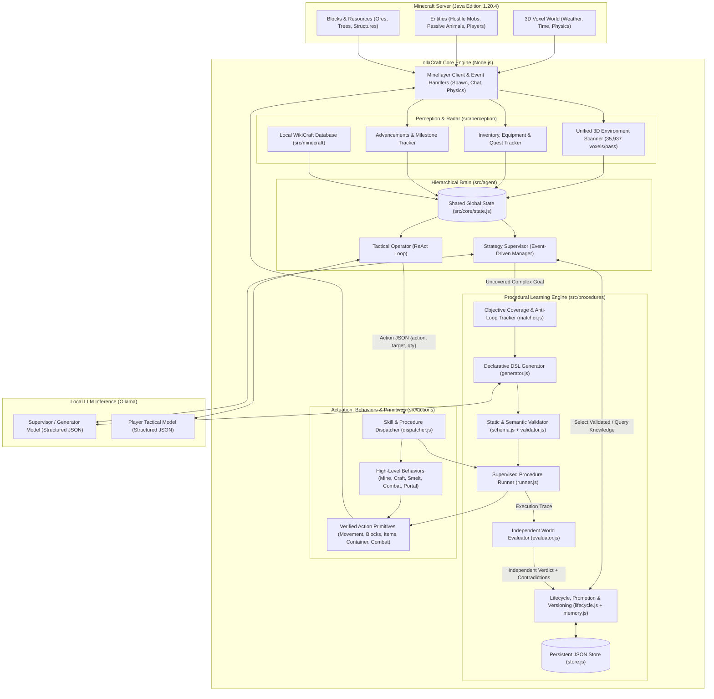
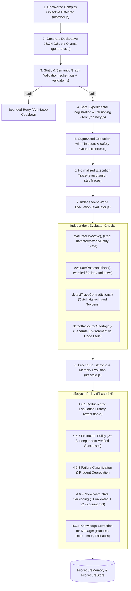

# 🗺️ Global System Architecture & Schematics - ollaCraft

**ollaCraft** is an autonomous survival and learning agent for **Minecraft Java Edition** powered by local Large Language Models (LLMs) via **Ollama** and interfaced with the game through **Mineflayer**.

The architecture combines a two-tier hierarchical cognitive system (**Strategy Manager** + **Tactical ReAct Player**), a deterministic **Action Primitives** layer, and an autonomous **Procedural Learning Engine (DSL + Evaluator + Lifecycle Memory)** inspired by Voyager, with **strict physical verification** against the real Minecraft world.

---

## 1. High-Level System Architecture

This diagram illustrates the separation of concerns across the Minecraft game server, the Node.js bot runtime, the Procedural Learning Engine, and the local LLM inference server.



---

## 2. Procedural Learning & Lifecycle Pipeline (Phase 4.1 → 4.6)

Unlike naive LLM agents that blindly trust step completion return codes, **ollaCraft** separates **execution** (`runner.js`), **physical verification** (`evaluator.js`), and **long-term memory evolution** (`lifecycle.js` & `memory.js`):



---

## 3. Hierarchical Decision Loop: Strategy Manager vs Tactical ReAct Player

1. **Strategy Manager** ([`src/agent/manager.js`](src/agent/manager.js)): Triggered on an **event-driven** basis (action failure, loop detected, objective milestone reached, inventory clutter, or heartbeat). It first checks `ProcedureMemory` for a **validated procedure** matching the current objective — if one exists, it bypasses step-by-step LLM inference and dispatches the validated procedure directly.
2. **Tactical ReAct Player** ([`src/agent/loop.js`](src/agent/loop.js)): Runs the **Perception &rarr; Dynamic Radar Prompt &rarr; Structured LLM Output &rarr; Skill/Procedure Dispatch (45s Timeout Guard) &rarr; Feedback** cycle.

---

## 4. Verified Action Primitives & Registry (`src/actions/primitives` & `src/procedures/registry.js`)

All autonomous procedures are composed exclusively of whitelisted, deterministic primitives with reentrant locking and post-action world verification:

| Domain | Module | Registered Primitives |
| :--- | :--- | :--- |
| **Movement** | [`src/actions/primitives/movement.js`](src/actions/primitives/movement.js) | `goto_position`, `goto_coordinates`, `move_direction`, `jump`, `look_at`, `stop_movement` |
| **Blocks** | [`src/actions/primitives/blocks.js`](src/actions/primitives/blocks.js) | `find_block`, `break_block`, `place_block`, `interact_block`, `collect_drops` |
| **Items** | [`src/actions/primitives/items.js`](src/actions/primitives/items.js) | `equip_item`, `unequip_item`, `craft_recipe`, `consume_item`, `drop_item`, `check_inventory` |
| **Container** | [`src/actions/primitives/container.js`](src/actions/primitives/container.js) | `open_container`, `deposit_item`, `withdraw_item`, `transfer_slot`, `close_container` |
| **Combat** | [`src/actions/primitives/combat.js`](src/actions/primitives/combat.js) | `find_entity`, `attack_entity`, `engage_combat`, `follow_entity`, `evade_entity` |

---

## 5. Benchmark & Performance Metrics (`npm run benchmark`)

Measured via [`scripts/benchmark.js`](scripts/benchmark.js) across **171 automated unit & integration tests**:

| Subsystem | Metric | Result | Architectural Impact |
| :--- | :--- | :--- | :--- |
| **DSL Schema + Semantic Validator** | Latency / Throughput | **0.030 ms/proc** (~33,780 proc/s) | Zero-cost static safety and dependency graph verification |
| **Supervised Runner + Evaluator** | Full Cycle Latency | **1.15 ms/cycle** | Sub-2ms orchestration and independent world verification |
| **Anti-Hallucination Guard** | False Positive Detection | **50/50 (100 %)** | Prevents learning from Desyncs or hallucinated step claims |
| **Lifecycle & Knowledge Engine** | Memory Update + Query | **0.45 ms/cycle** | Real-time promotion, versioning (`v1`/`v2`), and knowledge extraction |
| **Unified 3D Environment Scan** | 35,937 Voxels (Radius 16) | **2.32 ms/scan** | Single-pass block + exposed ore scanning with cached registry |
| **Cognitive Cost (10 Episodes)** | LLM Calls & Token Usage | **-90.0 % LLM calls / -90.0 % tokens** | Validated procedures replace repetitive step-by-step ReAct queries |

---

## 6. Directory Structure & Key Files

```text
ollaCraft/
├── ARCHITECTURE.md                  # Global system architecture, diagrams, and benchmarks
├── README.md                        # Quickstart, installation, commands, and usage guide
├── todo.md                          # Development roadmap and completed milestones
├── package.json                     # Dependencies and npm scripts (test, benchmark)
├── scripts/
│   └── benchmark.js                 # Automated performance and cognitive savings benchmark
├── src/
│   ├── index.js                     # Bot bootstrap, AuthMe authentication, server listeners
│   ├── core/
│   │   ├── state.js                 # Central runtime state (inventory, base, token stats)
│   │   └── logger.js                # Structured logging utility
│   ├── infrastructure/
│   │   ├── config.js                # Models, quest progression chain, action whitelists
│   │   └── env.js                   # Environment variable loader
│   ├── agent/
│   │   ├── loop.js                  # Tactical ReAct execution loop and timeout guards
│   │   ├── manager.js               # Event-driven Strategy Supervisor & procedure selector
│   │   ├── ollama.js                # Ollama REST client with structured JSON outputs
│   │   └── prompt.js                # Dynamic prompt builder with filtered 3D radar
│   ├── actions/
│   │   ├── dispatcher.js            # Routes skills and autonomous procedures
│   │   ├── primitives/              # Deterministic primitives (movement, blocks, items, container, combat, locks)
│   │   └── behaviors/               # High-level skills (mine, craft, smelt, place, navigate, combat, storage, portal)
│   ├── procedures/
│   │   ├── schema.js                # Declarative JSON DSL schema and dynamic reference resolver
│   │   ├── registry.js              # Whitelisted action catalog and parameter contracts
│   │   ├── validator.js             # Static & semantic validator (types, causal graph, preconditions)
│   │   ├── matcher.js               # Uncovered objective detector and anti-loop tracker
│   │   ├── generator.js             # Ollama DSL procedure generator with bounded retries
│   │   ├── runner.js                # Supervised experimental & validated procedure runner
│   │   ├── evaluator.js             # Independent objective, postcondition & contradiction evaluator
│   │   ├── lifecycle.js             # Evaluation history, promotion policy, failure analysis & versioning
│   │   ├── memory.js                # In-memory procedure registry, lineage manager & knowledge API
│   │   └── store.js                 # Persistent JSON storage with validated procedure protection
│   ├── perception/
│   │   ├── environment.js           # Unified 3D block & exposed ore scanner, entity radar
│   │   ├── inventory.js             # Item counting, tool selection, quest progression sync
│   │   └── advancements.js          # Vanilla Minecraft advancements tracker
│   └── minecraft/
│       ├── wiki.js                  # Offline recipe, drop, and tool lookup skill
│       └── wikiData.js              # Cached minecraft-data registry access
└── test/                            # 171 automated unit and end-to-end integration tests
```
