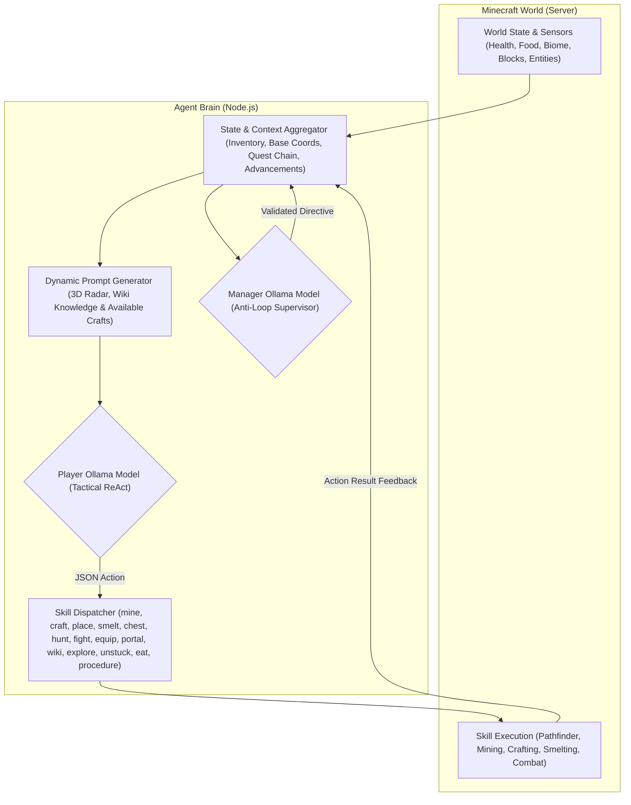

# ollaCraft - Autonomous Minecraft AI Agent (ReAct + Ollama)

An autonomous Minecraft survival agent powered by local Large Language Models (LLMs) via **Ollama** and built on **Mineflayer**. The bot continuously perceives its surrounding 3D environment, reasons about survival goals, and executes complex in-game skills through a closed-loop **ReAct (Reasoning + Acting)** architecture.

---

## 🌟 Highlights

- **Local LLM Intelligence:** Operates 100% locally and privately using Ollama (supporting models such as `qwen3.5:9B`, `qwen2.5:27b`, `llama3.1:8b`, or similar) with strict JSON Structured Outputs.
- **Autonomous Procedural Learning Engine (Phase 4):** Generates, validates, executes, and evaluates declarative multi-step procedures (`src/procedures/`). Distinguishes technical step completion from real-world objective achievement, detects trace contradictions, and promotes reliable procedures from `experimental` to `validated` while reducing LLM token usage by **up to 90%**.
- **Two-Tier Event-Driven ReAct Decision Loop:** Structured cycle of **Perception -> Dependency Plan / Prompt Synthesis -> Validated Procedure Bypass or LLM Reasoning -> Physical Verification -> Event-Driven Supervisor Review**.
- **Anti-Looping Strategy Manager:** A supervisor pass monitors action history, detects repeated failures or ping-pong loops, prioritizes validated procedures from `ProcedureMemory` (bypassing Player LLM calls), and sanitizes directives against real inventory, terrain, and furnace/table accessibility constraints.
- **Autonomous Progression Chain:** Naturally advances through survival tiers:

```mermaid
flowchart LR
    A["Logs"] --> B["Wooden Pickaxe"]
    B --> C["Cobblestone"]
    C --> D["Stone Pickaxe"]
    D --> E["Furnace"]
    E --> F["Iron Gear & Shield"]
    F --> G["Water Bucket & Flint & Steel"]
    G --> G2["Spawn Bed"]
    G2 --> H["Nether Portal"]
    H --> I["Blaze Rods & Ender Eyes"]
    I --> J["Bow & Arrows"]
    J --> K["Stronghold (2-eye triangulation)"]
    K --> L["Spawn Bed + End Portal"]
    L --> M["Ender Dragon"]
```



- **Deterministic Dependency Planner (LLM bypass):** `src/agent/planner.js` executes the next feasible step of the recursive dependency plan (`craft`, `mine`, `smelt`, `hunt`...) and the stage logistics (portal return, stronghold, End) **without any model call**. The LLM is only consulted when no deterministic step exists or when a step keeps failing.
- **Contextual Failure Memory & Loop Breaker:** `src/agent/recovery.js` remembers where and with what inventory an `(action, target)` pair failed. After 2 failures in the same situation the pair is refused **at that spot** and the bot relocates without any model call; the refusal lifts as soon as it has moved 6 blocks or its inventory changed, so the step is simply retried elsewhere. Only a step that failed in several different places is handed to the model. Stagnation (no change of inventory, position or objective) forces a *different* action, and the same mechanism is exposed to players through the `debug` chat command.
- **Portable Crafting Table:** the bot carries a single crafting table. `craft` deploys it where the bot stands, crafts, then **breaks it and picks it back up**. No table position is ever memorized or walked back to. Deployment scans the cells around the bot, never picks one its own body overlaps (the server refuses those), places through grass, and tries up to three spots.
- **Spawn Protection Awareness:** when the server refuses a placement next to the world spawn, the bot remembers it and, after every respawn, walks straight out of the protected radius before trying to place or break anything.
- **Survival Watchdog:** `src/agent/watchdog.js` aborts the running action and heads for air when the air supply runs low, since a skill can hold the bot under water longer than its air lasts.
- **Water Escape:** `mineflayer-pathfinder` always holds jump in water and therefore cannot dive: in a flooded gallery it pins the bot against the ceiling. `src/actions/behaviors/movement/water.js` searches the water for the quickest route to air (swimming down or sideways, or breaking a thin wall or ceiling when that is faster), swims it with direct controls, then reaches dry ground. A flooded cave the bot had to escape from is remembered for 15 minutes: the bot leaves it, and blocks under water are no longer mining targets.
- **Milestone Waypoints:** portals (both sides), spawn beds, fortress, stronghold, End portal and the last death position are saved to `data/progress-*.json` and survive deaths and restarts (`goto` skill).
- **Spawn Beds:** a bed is placed and used to set the respawn point before entering the Nether, and again in the stronghold before entering the End.
- **Stronghold Triangulation:** exactly two Eyes of Ender thrown from two positions give two bearings whose intersection is the stronghold (`src/minecraft/triangulation.js`).

- **Data-Driven Tool Selection:** 100% driven by `minecraft-data` (`harvestTools`, `digTime` vs bare hands, and `material`), overriding `mineflayer-pathfinder`'s `bestHarvestTool` and safely unequipping unrelated tools or weapons before digging.
- **Nether Portal Automation:** Detects active `nether_portal` blocks, complete unlit frames, and partial/ruined obsidian frames on both X and Z axes (`findPortalFrameCandidate`); completes frames with carried obsidian or water-cascade lava mold casting (`castPortalWithMold`), automatically gathers 12 building blocks beside lava pools before casting, clears doorway obstructions, ignites with `flint_and_steel`, and transitions into `the_nether`.
- **Smart Pathfinding & Unstuck Recovery:** Powered by `mineflayer-pathfinder` with persistent outward exploration, 32×32 box-trap breakout (+90° rotation with dig breakout), solid-ceiling cave detection (`hasSolidCeilingAbove`), bounded 34s explore budgets, and dry-land water escape (`findNearestDryLand` / `swimToDryLand`).
- **Full Combat & Vitality Safeguards:** Weapon selection, automatic armor and off-hand shield equipping, passive animal hunting, hostile mob combat, and food consumption.
- **Crafting, Smelting & Automatic Inventory Pressure Relief:** Finds or places crafting tables, operates furnaces with fuel matching, organizes chest storage, and drops disposable clutter (`freeInventorySlotIfFull`: flowers, saplings, surplus bulk blocks) before crafting, smelting, or scooping liquids when inventory is full.
- **Built-in Minecraft Wiki Database:** Queries local game metadata (`minecraft-data`) for recipes, drop tables, and harvest tool requirements.

---

## 🏗️ Architecture



---

## 📁 Project Structure

```text
├── scripts/
│   └── benchmark.js           # Performance & cognitive token-savings benchmark suite
├── src/
│   ├── index.js               # Entry point, bot connection, server chat & event listeners
│   ├── core/                  # Central runtime state (state.js), persisted waypoints & milestones (progress.js)
│   ├── infrastructure/        # Configuration (config.js) and environment loader
│   ├── agent/                 # ReAct loop (loop.js), deterministic planner (planner.js), failure memory & loop breaker (recovery.js),
│   │                          # goal command (goals.js), Supervisor (manager.js), Ollama client & Prompt builder
│   ├── actions/
│   │   ├── dispatcher.js      # Central router for skills and autonomous procedures
│   │   ├── primitives/        # Verified primitives (movement, blocks, items, container, combat, locks)
│   │   └── behaviors/         # High-level skills (mine, craft, portable table, smelt, place, navigate, waypoint travel,
│   │                          # combat, dragon, storage, portal, bed, stronghold, endportal)
│   ├── procedures/            # Procedural Learning Engine (schema, registry, validator, matcher, generator, runner, evaluator, lifecycle, memory, store)
│   ├── perception/            # Unified 3D scanner with TTL bad-block sync (environment.js), inventory, quests & advancements
│   └── minecraft/             # Offline WikiCraft lookups (wiki.js, wikiData.js), dependency resolver (knowledge.js), eye triangulation (triangulation.js)
├── data/procedures/           # Persisted JSON procedures (mounted via Docker volume ./data:/app/data)
├── data/progress-*.json       # Persisted waypoints, milestones and stronghold estimate (one file per server/account)
├── test/                      # 214 automated unit and E2E integration tests across 20 test files
├── Dockerfile                 # Node 20 Alpine image build for ollacraft-bot
├── Makefile                   # Shortcuts (run, bot, bot-logs, bot-stop, test)
├── docker-compose.yml         # Paper server + ollacraft-bot service (--profile bot) with /app/data persistence
├── .env.example               # Template for environment variables
├── ARCHITECTURE.md            # Detailed schematics, sequence diagrams & benchmark metrics
├── package.json               # Dependencies and scripts (test, benchmark)
└── README.md                  # Project documentation
```

---

## 📋 Prerequisites

Before starting, ensure you have:

1. **Node.js** (v20+ recommended to match `Dockerfile` `node:20-alpine`; v18.0.0 minimum):
   ```bash
   node --version
   ```
2. **Minecraft Java Edition Server** (v1.20.4 recommended):
   - A vanilla, Fabric, Paper, or Spigot server.
   - For local offline development, set `online-mode=false` in `server.properties`.
3. **Ollama**:
   - Installed from [ollama.com](https://ollama.com).
   - Ensure Ollama is running and has downloaded the desired model:
     ```bash
     ollama serve
     ollama pull qwen2.5:27b

     # Or for lighter hardware:
     ollama pull llama3.1:8b
     
     # show ollama models in local:
     ollama list
     ```

---

## 🚀 Installation & Setup

1. **Clone the repository:**
   ```bash
   git clone https://github.com/Gw3nhael51/ollaCraft.git
   cd ollaCraft
   ```

2. **Install Node.js dependencies:**
   ```bash
   npm install
   ```

3. **Configure Environment Variables:**
   Copy `.env.example` to `.env`:
   ```bash
   cp .env.example .env
   ```
   Edit `.env` to match your Minecraft server and Ollama settings:
   ```env
   # Minecraft connection settings
   MC_HOST=127.0.0.1
   MC_PORT=25565
   MC_USERNAME=Ollama
   MC_PASSWORD=YourBotPasswordIfRequired

   # Ollama settings (Dual-Model Architecture)
   OLLAMA_MODEL=qwen3.5:9B
   OLLAMA_MODEL_PLAYER=qwen3.5:9B
   OLLAMA_MODEL_MANAGER=qwen3.5:9B
   ```

4. **Launch locally:**
   ```bash
   node src/index.js
   ```

### Docker Deployment (Recommended)

Start a local Paper 1.20.4 Minecraft server (`mc-server`):
```bash
docker compose up -d
# Or via Makefile:
make run
```

Build and launch `ollacraft-bot` (`--profile bot`, connects to local `MC_HOST` or a remote server):
```bash
docker compose --profile bot up -d --build --no-deps bot
# Or via Makefile:
make bot
make bot-logs
make bot-stop
```

The bot will connect to the target Minecraft server. If the server has an authentication plugin (`/register` or `/login`), the bot will handle it automatically based on `MC_PASSWORD`. Once connected, the autonomous ReAct cycle starts.

---

## 🎮 In-Game Controls & Chat Commands

Players can interact with and command the bot directly using in-game chat:

| Command | Description |
|---|---|
| `start` | Starts or resumes the autonomous ReAct survival loop. |
| `stop` | Immediately suspends the autonomous loop, clears current pathfinding, and resets controls. |
| `objectif <item> [qty]` or `goal <item> [qty]` | Gives the bot a direct objective (e.g., `objectif diamond 3`, `objectif pioche en fer`, `objectif dragon`). If it is not directly reachable, the bot builds and announces the prerequisite chain and follows it (e.g. `mine iron_ore x3 -> smelt raw_iron x3 -> craft iron_pickaxe -> mine diamond_ore x3`). Once obtained, the automatic chain resumes. |
| `objectif auto` or `goal auto` | Restores the default automatic survival quest progression chain. |
| `debug` (aliases `debloque`, `coince`, `unstuck`) | Loop breaker: prints a diagnostic, cancels the running action, refuses the action the bot was repeating at that spot and forces a **different** action (unstuck, relocation, return to a waypoint). |
| `debug info` | Diagnostic only (objective, last action, history, stagnation counters, refused actions, LLM vs planned decision counts). |
| `plan` | Prints the dependency chain of the current objective from the current inventory. |
| `waypoints` or `reperes` | Lists the memorized milestone coordinates (portals, spawn beds, fortress, stronghold, End portal, last death). |
| `inventaire` or `inv` | Causes the bot to output its current inventory contents into chat. |
| `coords` or `pos` | Outputs the bot's current `(X, Y, Z)` coordinates into chat. |
| `tokens` or `token` | Outputs token consumption statistics for both LLMs, plus how many decisions were taken without any model call. |

---

## ⚙️ Configuration Reference

### Environment Variables (`.env`)

| Variable | Default | Description |
|---|---|---|
| `MC_HOST` | `localhost` (`127.0.0.1` in `.env.example`) | Minecraft server hostname or IP address. |
| `MC_PORT` | `25565` | Minecraft server port. |
| `MC_USERNAME` | `Ollama` | In-game player name for the bot. |
| `MC_PASSWORD` | *(Empty)* | Password used for server `/register` or `/login` commands. |
| `MC_AUTH_PLUGIN` | `true` if `MC_PASSWORD` is set, else `false` | Set to `false` when the server has no `/register` / `/login` plugin: the bot then starts right after spawning. |
| `OLLAMA_HOST` | `http://localhost:11434` | Ollama REST API base URL. |
| `OLLAMA_MODEL` | `qwen3.5:9B` | Fallback Ollama model tag. |
| `OLLAMA_MODEL_PLAYER` | `qwen3.5:9B` | Dedicated model for tactical ReAct decisions. |
| `OLLAMA_MODEL_MANAGER` | `qwen3.5:9B` | Dedicated model for strategic supervision and loop recovery. |
| `ENABLE_PROCEDURE_GENERATION` | `true` | Experimental procedure generation in `manager.js`. `true`: only for objectives the deterministic planner cannot handle; `always`: unconditional; `false`: disabled. |
| `DETERMINISTIC_PLANNER` | `true` | Execute known plan steps without calling the LLM (`false` restores a model call every cycle). |
| `REQUIRE_SPAWN_BED` | `true` | Require a spawn bed before the Nether portal and before the End portal (`false` to skip both bed quests). |
| `EYE_TRIANGULATION_BASELINE` | `250` | Sideways distance (blocks) walked between the two Eye of Ender throws. A longer baseline gives a more accurate intersection. |
| `OLLAMA_NUM_CTX` | `8192` | Context window sent to Ollama. The ReAct prompt does not fit in Ollama's small default and would be silently truncated. |
| `OLLAMA_NUM_PREDICT` | `512` | Safety cap on generated tokens per decision. The answer schema already bounds the reasoning text; a cap set too low cuts the JSON before its end. |
| `SPAWN_PROTECTION_RADIUS` | `16` | Radius of the server's `spawn-protection`. Once a placement has been refused near the world spawn, the bot leaves this radius before building. |
| `OLLAMA_KEEP_ALIVE` | `30m` | How long Ollama keeps the model loaded between cycles. |
| `PORT` | `127.0.0.1:25565:25565` | Optional Docker port mapping for `mc-server`. |

### Bot Rules & Parameters (`src/infrastructure/config.js`)

- **Quest Chain:** Progresses from wooden, stone, and iron gear plus `shield` through `bucket`, `water_bucket`, `flint_and_steel`, `bed`, `nether_portal`, `blaze_rod`, `blaze_powder`, `ender_pearl`, `ender_eye`, `bow`, `arrow`, `end_bed`, `stronghold`, `end_portal` and `ender_dragon` (`QUEST_CHAIN` & `QUEST_AMOUNT`). The number of eyes required is dynamic: 12 frames minus the frames already filled, plus the triangulation throws still to do. Steps the inventory has already made pointless are skipped: when a later quest can be crafted outright from what is carried (wood + stone → `stone_pickaxe`, wood + 3 iron ingots → `iron_pickaxe`), the bot goes straight to it instead of replaying the lower tiers. Cobbled deepslate and blackstone count as stone for stone tools and the furnace.
- **Action Whitelist:** Strict validation of allowed LLM actions (`VALID_ACTIONS`) and valid placement surfaces (`VALID_GROUND_BLOCKS`).
- **Base Management & Recovery:** `furnace` and `chest` coordinates are kept in `src/core/state.js` and reset on `death` alongside temporary TTL blacklists. The crafting table is portable and never memorized. Milestone waypoints are **kept** on death so the bot walks back to its portal or stronghold.

---

## 🧰 Available Agent Skills

The ReAct loop provides the LLM with structured actions formatted in JSON:

| Skill | Parameters | Description |
|---|---|---|
| `mine` | `target: string, qty?: number` | Finds the closest target block, equips the optimal tool dynamically via `minecraft-data` (`harvestTools` and `digTime`), and mines it (with BFS vein mining for ores). |
| `craft` | `target: string, qty?: number` | Crafts an item using the 2x2 player inventory. For 3x3 recipes (including items that also have a 2x2 recipe the inventory cannot make, like a bed's re-dye recipe) it deploys the carried crafting table on the spot, crafts, then breaks the table and collects it (it stays deployed only when the very next plan step is another table recipe). |
| `place` | `target: string` | Places a block from inventory on safe, valid adjacent ground (`furnace`, `chest`). A manually placed `crafting_table` is tracked and collected as soon as the bot moves on. |
| `smelt` | `target: string, qty?: number` | Approaches a furnace, loads fuel (coal/charcoal/wood), and smelts raw ores or food. |
| `chest` | *None* | Navigates to a nearby chest and deposits bulky materials (excess dirt, cobblestone, mob drops). |
| `hunt` | `target?: string` | Hunts nearby passive animals (`cow`, `pig`, `sheep`, `chicken`) for food or materials, then walks onto the dropped items to pick them up. Babies, sheared sheep and animals found unreachable (for 3 min) are skipped; `sheep` and `chicken` are never replaced by another species, and sheep of the wool color already carried come first (a bed needs three of one color). |
| `fight` | `target?: string` | Engages nearby hostile mobs (`zombie`, `skeleton`, `spider`, `blaze`) with best weapon and armor. |
| `equip` | `target?: string` | Equips best available armor pieces and places the shield in the off-hand slot. |
| `portal` | *None* | Detects active `nether_portal` blocks as well as complete unlit or partial obsidian frames on X/Z axes, fills `water_bucket`, casts or completes frames via water-cascade lava mold or carried obsidian, clears doorway obstructions, ignites with `flint_and_steel`, sets the spawn bed next to the portal, memorizes both portal sides and enters `the_nether`. From the Nether, target `overworld` walks back to the memorized portal and returns. |
| `eat` | `target?: string` | Scans inventory for an edible food item and consumes it. |
| `explore` | `target?: string` | Advances along a persistent outward heading (with optional target hint like `'lava'`), detects solid ceilings (`hasSolidCeilingAbove`), breaks out of 32×32 box traps (+90° with dig breakout), and runs within a bounded 34s budget. An ore target (`diamond`, `iron_ore`...) digs a staircase down to the altitude where that ore generates; a surface target (trees and wood, animals) first climbs out of the mine or cave leg by leg, through the existing galleries or by digging a staircase, until the sky is open; `relocate` (used by the loop breaker) turns away from the current area. |
| `unstuck` | *None* | In water: finds a route to air (straight up when the surface is open, otherwise diving through the flooded gallery or breaking a thin wall or ceiling), then reaches dry ground; reports failure when the bot is still in the water. On land: breaks the ceiling, digs through any wall its tools break quickly, or climbs out with the pathfinder. |
| `goto` | `target: string` | Travels back to a memorized waypoint (`nether_portal`, `nether_exit`, `spawn_bed`, `end_spawn_bed`, `fortress`, `stronghold`, `end_portal`, `death`), one bounded leg per call. |
| `bed` | `target?: string` | Places the carried bed (crafting it from 3 same-colored wool + 3 planks if possible) and uses it to set the respawn point. `pickup` breaks and recovers the spawn bed. |
| `stronghold` | *None* | Throws an Eye of Ender and measures its bearing from the entity's flight, walks `EYE_TRIANGULATION_BASELINE` blocks sideways, throws a second eye, intersects both bearings, then travels to the estimate. |
| `endportal` | *None* | Scans loaded chunks for the End portal frame around the estimate, digs to the portal room, sets the spawn bed, fills the empty frames with Eyes of Ender and enters the End. |
| `dragon` | *None* | In the End: reaches the main island, shoots End crystals with a gravity-compensated bow, shoots or strikes the dragon when in range, and detects victory from the active exit portal. |
| `wiki` | `target: string` | Looks up recipes, tool requirements, and drops for any block or item in the local game database. |
| `procedure` | `target: string \| object, qty?: number \| object` | Executes a validated or experimental multi-step DSL procedure from `ProcedureMemory` under supervision and records its lifecycle evaluation. |

---

## 🧪 Automated Tests & Benchmark

Run the full test suite (**214 unit & integration tests across 20 suites**):
```bash
npm test
```

Run the architecture & procedural learning benchmark:
```bash
npm run benchmark
```

### Validation status of the end-game stages

The planner, failure memory, portable crafting table, spawn bed, waypoints, goal command and triangulation math are covered by automated offline tests against simulated worlds (`test/endgame_autonomy.test.js`, `test/chat_commands.test.js`). The stages that depend on live server behavior (eye flight tracking, stronghold digging, End portal entry and the Ender Dragon fight) have **not yet been validated in a real game**: expect to tune them during in-game test campaigns. Known limits of the dragon fight: End crystals protected by iron cages are not handled, and without a bow the crystals keep healing the dragon.

---

## 🛠️ Troubleshooting

### 1. Ollama Connection Issues
- **Error:** `fetch failed` or `ECONNREFUSED 127.0.0.1:11434`
- **Solution:** Verify that Ollama is running (`ollama serve`). Test with `curl http://127.0.0.1:11434/api/tags` in your terminal.

### 2. Bot Getting Disconnected
- **Error:** `Server closed connection` or `Invalid credentials`
- **Solution:** If the server is in online mode (`online-mode=true`), the bot must use official Microsoft credentials. For local testing, set `online-mode=false` in `server.properties`.

### 3. Blocks Refused Near the World Spawn
- **Symptom:** `Server refused to place ... the block is still air`, or blocks reappearing right after being mined, always close to where the bot respawns.
- **Cause:** as soon as one player is an operator, the server's `spawn-protection` (16 blocks by default) forbids non-operators from placing or breaking blocks around the world spawn.
- **Solution:** the provided `docker-compose.yml` sets `SPAWN_PROTECTION: "0"`; on an existing server set `spawn-protection=0` in `server.properties` and restart it. Without that, the bot detects the refusal and walks out of the radius by itself after each respawn.

### 4. Navigation Timeouts
- **Symptom:** Bot attempts to reach a block but logs `Navigation timeout`.
- **Solution:** This is normal behavior when a block is unreachable (e.g., suspended high in the air or sealed behind bedrock). The bot's built-in blacklist automatically ignores failed coordinates for subsequent steps.

---

## 🧠 Real-World ReAct Reasoning Trace

Below is an authentic execution trace showing how the local LLM encounters unforeseen obstacles (unreachable pathfinder target, missing crafting table in inventory), evaluates failure feedback, and autonomously recovers step-by-step to craft the required components:

```text
=== REACT THINKING CYCLE (objective : stone_pickaxe) ===
[AI THOUGHT] I already own a wooden pickaxe and a stone one. My objective is to obtain a 'stone_pickaxe'. According to the fundamental rule, I must not invent recipes. I check my situation: I need to mine 'stone' to get 'cobblestone', then craft them with sticks. However, before mining, I must ensure I don't need to consult the Wiki to confirm the exact recipe or if a specific action is required. But looking at my resources, I already have 159 cobblestone and only 1 stick. I am therefore lacking sticks. The priority is to obtain sticks. To do that, I need to chop wood with my stone or wooden axe. I have plenty of logs in my inventory but no processed planks to make sticks easily without crafting planks first. Wait, the standard recipe is 3 cobblestone + 2 sticks. I only have 1 stick. So I must craft some. To craft a stick, do you chop wood (log) -> plank -> stick? Right, in vanilla Minecraft: Log -> Planks (4x) -> Sticks (2x). So I must craft planks then sticks. Or mine 'stone' if I had enough sticks. I only have 1 stick. I will therefore use my axe to chop wood (jungle_log or oak_log) to get more resources to make sticks, or craft planks then sticks directly. But the 'mine' action is for blocks on radar. The radar shows trees ('oak_leaves', 'jungle_leaves', etc.) but no exposed trunk specifically listed as a direct mineable target (radar lists 'oak_log':22, 'jungle_log':62). I can mine these logs. So action: mine a log to obtain raw wood, then I'll craft planks and sticks. Or else, I can use the 'craft' action if I have the ingredients. I don't have enough sticks. I must therefore chop wood. The radar indicates 'oak_log':22 and 'jungle_log':62. I will mine an oak_log.
[MINE] Moving towards oak_log...
[SERVER] <Ollama> Action : mine (oak_log)
Mining failure : Took too long to decide path to goal!
[RESULT] ❌ Mining failed for 'oak_log' : Block unreachable (Took too long to decide path to goal!).

=== REACT THINKING CYCLE (objective : stone_pickaxe) ===
[AI THOUGHT] The objective is to craft a stone pickaxe (stone_pickaxe). The recipe requires 3 cobblestone and 2 sticks. I already have 159 cobblestone in my inventory, so I don't need to mine stone. I only possess a single stick ('stick'), whereas I need 2. I must therefore craft another one. To do that, I will first place a crafting table if not already done (there is one visible on the radar), then craft a stick with wood planks (I have plenty of wood). Once the 2 sticks are obtained, I can craft the pickaxe.
[RESULT] ❌ You do not have 'crafting_table' in your inventory.
[SERVER] <Ollama> Action : place (crafting_table)

=== REACT THINKING CYCLE (objective : stone_pickaxe) ===
[AI THOUGHT] The previous action failed because I didn't have a crafting table in my inventory. I must therefore craft one first (3 planks + 1 stick). I have the necessary resources (wood and sticks) to create planks and then the table. I will start by crafting 'crafting_table'.
[CRAFT] Moving to crafting table at (422, 76, -284)...
[SERVER] <Ollama> Action : craft (crafting_table)
[RESULT] ❌ Missing required components in inventory to craft 'crafting_table'.

=== REACT THINKING CYCLE (objective : stone_pickaxe) ===
[AI THOUGHT] Crafting the table failed because I don't have planks. I must first convert my logs (jungle_log, birch_log, oak_log) into planks in order to craft the crafting table. I have enough wood to start.
[SERVER] <Ollama> Action : craft (oak_planks)
[SERVER] <Ollama> Crafting oak_planks...
[RESULT] ✅ Successfully crafted 'oak_planks'.
```

## ⛏️ Connected Ore Vein Mining Trace

Example trace demonstrating the automated BFS vein-mining algorithm recursively clearing an entire cluster of adjacent `coal_ore` blocks without leaving remaining ores:

```text
[MINE] Moving towards coal_ore...
[MINE] Digging coal_ore...
[MINE] Block broken, collecting loot...
[VEIN] Extracting additional vein block (coal_ore) at (416,68,-284)...
[VEIN] Extracting additional vein block (coal_ore) at (416,68,-283)...
[VEIN] Extracting additional vein block (coal_ore) at (415,68,-283)...
[VEIN] Extracting additional vein block (coal_ore) at (416,69,-283)...
[VEIN] Extracting additional vein block (coal_ore) at (416,68,-282)...
[VEIN] Extracting additional vein block (coal_ore) at (415,69,-283)...
[VEIN] Extracting additional vein block (coal_ore) at (417,69,-283)...
[VEIN] Extracting additional vein block (coal_ore) at (417,68,-282)...
[MINE] Moving towards coal_ore...
```

## 📄 License

Copyright &copy; 2026 Gw3nhael51. All rights reserved.

This project is source-available for **personal evaluation and educational purposes only**. Redistribution, sublicensing, modification, copying, or commercial exploitation is strictly prohibited without prior written permission from the author. See [LICENSE](LICENSE) for full details.
