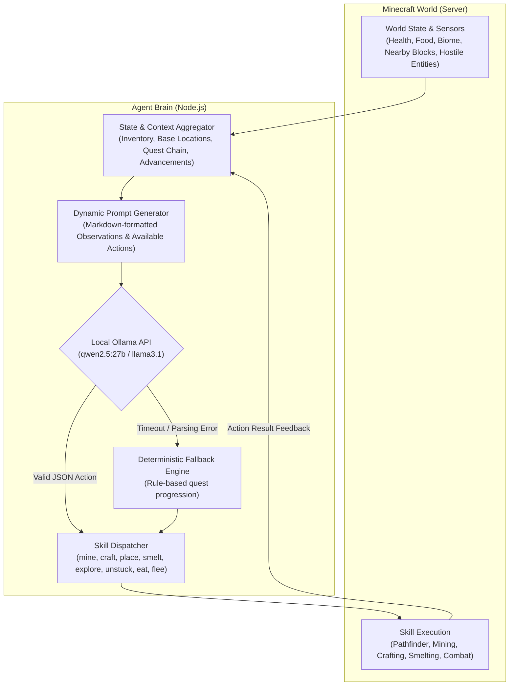

# Autonomous Minecraft AI Agent (ReAct + Ollama)

An autonomous Minecraft survival agent powered by local Large Language Models (LLMs) via **Ollama** and built on **Mineflayer**. The bot continuously perceives its surrounding 3D environment, reasons about survival goals, and executes complex in-game skills through a closed-loop **ReAct (Reasoning + Acting)** architecture.

---

## 🌟 Highlights

- **Local LLM Intelligence:** Operates 100% locally and privately using Ollama (supporting models such as `qwen2.5:27b`, `llama3.1:8b`, or similar).
- **ReAct Decision Loop:** Structured cycle of **Perception &rarr; Prompt Synthesis &rarr; LLM Reasoning & Plan &rarr; Skill Execution &rarr; Environment Feedback**.
- **Deterministic Heuristic Fallback:** If the LLM produces invalid JSON, encounters an API timeout, or hallucinates an unreachable goal, a rule-based fallback immediately takes over to maintain uninterrupted survival.
- **Autonomous Progression Chain:** Naturally advances through survival tiers:
  $$\text{Logs} \rightarrow \text{Wooden Pickaxe} \rightarrow \text{Cobblestone} \rightarrow \text{Stone Pickaxe} \rightarrow \text{Furnace} \rightarrow \text{Iron Gear} \rightarrow \text{Diamonds} \dots$$
- **Smart Pathfinding & Unstuck Recovery:** Powered by `mineflayer-pathfinder` with 3D cave/terrain obstacle analysis, jump-scaffolding, and automatic unstuck routines for holes, water, or deep pits.
- **Full Combat & Vitality Safeguards:** Automatic mob threat assessment, tactical fleeing when low on health, weapon selection, shield blocking, and proactive eating.
- **Crafting, Smelting & Storage Automation:** Finds or places crafting tables, operates furnaces with fuel matching, and organizes chest storage to deposit bulky materials.
- **Built-in Minecraft Wiki Database:** Queries local game metadata (`minecraft-data`) for recipes, drop tables, and harvest tool requirements.

---

## 🏗️ Architecture



---

## 📁 Project Structure

```text
├── src/
│   ├── index.js               # Entry point, bot connection, server chat & event listeners
│   ├── config.js              # Global configuration, quest chain, timing, and item thresholds
│   ├── state.js               # Central runtime state (inventory, health, memory, base coordinates)
│   ├── ai/
│   │   ├── loop.js            # Main ReAct loop, action execution cycle, and fallback triggers
│   │   ├── ollama.js          # Ollama REST client, payload formatting, and JSON extraction
│   │   └── prompt.js          # Dynamic system and user prompt constructor
│   ├── skills/
│   │   ├── dispatcher.js      # Central router mapping action names to skill functions
│   │   ├── mine.js            # Target block search, pathfinding, and mining with best tool
│   │   ├── craft.js           # Crafting table detection/placement and 2x2/3x3 recipe crafting
│   │   ├── smelt.js           # Furnace placement, fuel selection, and smelting operations
│   │   ├── place.js           # Physical block placement (crafting tables, furnaces, chests)
│   │   ├── navigate.js        # Safe exploration, obstacle avoidance, sleeping, and unstuck
│   │   ├── combat.js          # Mob combat, fleeing, armor auto-equip, and shield defense
│   │   ├── eat.js             # Food selection and eating routines
│   │   ├── storage.js         # Chest sorting and bulky item depositing
│   │   └── wiki.js            # Game data lookups (recipes, harvest tools, drops)
│   └── utils/
│       ├── environment.js     # 3D block scanner, exposed ore locator, entity tracking, biomes
│       ├── inventory.js       # Item counting, tool selectors, craft availability checks
│       ├── advancements.js    # Story advancements progression and badge URL builder
│       └── wikiData.js        # Minecraft registry access and harvest verification
├── .env.example               # Template for environment variables
├── package.json               # Dependencies and scripts
└── README.md                  # Project documentation
```

---

## 📋 Prerequisites

Before starting, ensure you have:

1. **Node.js** (v18.0.0 or higher):
   ```bash
   node --version
   ```
2. **Minecraft Java Edition Server** (v1.20.4 recommended):
   - A vanilla, Fabric, Paper, or Spigot server.
   - For local offline development, set `online-mode=false` in `server.properties`.
3. **Ollama**:
   - Installed from [ollama.com](https://ollama.com).
   - Ensure Ollama is running and has downloaded the desired model:
     ```bash
     ollama serve
     ollama pull qwen2.5:27b

     # Or for lighter hardware:
     ollama pull llama3.1:8b
     
     # show ollama models in local:
     ollama list
     ```

---

## 🚀 Installation & Setup

1. **Clone the repository:**
   ```bash
   git clone https://github.com/Gw3nhael51/ollacraft.git
   cd ollacraft
   ```

2. **Install Node.js dependencies:**
   ```bash
   npm install
   ```

3. **Configure Environment Variables:**
   Copy `.env.example` to `.env`:
   ```bash
   cp .env.example .env
   ```
   Edit `.env` to match your Minecraft server and Ollama settings:
   ```env
   # Minecraft connection settings
   MC_HOST=127.0.0.1
   MC_PORT=25565
   MC_USERNAME=Herobrine
   MC_PASSWORD=YourBotPasswordIfRequired

   # Ollama settings
   OLLAMA_MODEL=qwen2.5:27b
   ```

4. **Launch the agent:**
   ```bash
   node src/index.js
   ```

The bot will connect to the target Minecraft server. If the server has an authentication plugin (`/register` or `/login`), the bot will handle it automatically based on `MC_PASSWORD`. Once connected, the autonomous ReAct cycle starts.

---

## 🎮 In-Game Controls & Chat Commands

Players can interact with and command the bot directly using in-game chat:

| Command | Description |
|---|---|
| `start` | Starts or resumes the autonomous ReAct survival loop. |
| `stop` | Immediately suspends the autonomous loop, clears current pathfinding, and resets controls. |
| `objectif <item>` or `goal <item>` | Manually sets the agent's target objective (e.g., `objectif diamond_pickaxe`). |
| `objectif auto` or `goal auto` | Restores the default automatic survival quest progression chain. |
| `inventaire` or `inv` | Causes the bot to output its current inventory contents into chat. |
| `coords` or `pos` | Outputs the bot's current $(X, Y, Z)$ coordinates into chat. |

---

## ⚙️ Configuration Reference

### Environment Variables (`.env`)

| Variable | Default | Description |
|---|---|---|
| `MC_HOST` | `127.0.0.1` | Minecraft server hostname or IP address. |
| `MC_PORT` | `25565` | Minecraft server port. |
| `MC_USERNAME` | `Herobrine` | In-game player name for the bot. |
| `MC_PASSWORD` | *(Empty)* | Password used for server `/register` or `/login` commands. |
| `OLLAMA_MODEL` | `qwen2.5:27b` | Ollama model tag (`qwen2.5:27b`, `llama3.1:8b`, `mistral`, etc.). |
| `PORT` | `127.0.0.1:25565:25565` | Optional Docker port mapping. |

### Bot Rules & Parameters (`src/config.js`)

- **Survival Delay:** Configured delay between consecutive ReAct decisions (`config.LOOP_DELAY_MS`).
- **Quest Chain:** Linear fallback progression from `oak_log` up to `diamond` tools and armor.
- **Safety Thresholds:** Health and hunger limits that trigger immediate fleeing or eating before continuing tasks.
- **Base Management:** Stored coordinates for the player base, placed crafting tables, furnaces, and storage chests.

---

## 🧰 Available Agent Skills

The ReAct loop provides the LLM with structured actions formatted in JSON:

| Skill | Parameters | Description |
|---|---|---|
| `mine` | `target: string` | Finds the closest target block in the world, navigates to it, equips the optimal tool, and mines it. |
| `craft` | `item: string` | Crafts an item using 2x2 player inventory or navigates to/places a crafting table for 3x3 recipes. |
| `place` | `blockName: string` | Places a block from inventory on safe, valid adjacent ground (e.g., `crafting_table`, `furnace`, `chest`). |
| `smelt` | `item: string` | Places or approaches a furnace, loads fuel (coal/charcoal/wood), and smelts raw ores or food. |
| `explore` | *None* | Selects a safe, unvisited terrain location and walks forward to discover new resources. |
| `unstuck` | *None* | Performs emergency jump-and-place or wall mining maneuvers to escape deep pits, 1x1 holes, or water. |
| `eat` | *None* | Scans inventory for the highest-nourishment food item and consumes it. |
| `store_chest` | *None* | Navigates to a nearby chest and deposits bulky materials (dirt, excess cobblestone, mob drops). |
| `flee` | *None* | Retreats from nearby hostile mobs to recover health in safety. |
| `sleep` | *None* | Searches for a nearby bed during night or thunderstorm to pass the night safely. |
| `wiki` | `target: string` | Looks up recipes, tool requirements, and drops for any block or item in the game database. |

---

## 🛠️ Troubleshooting

### 1. Ollama Connection Issues
- **Error:** `fetch failed` or `ECONNREFUSED 127.0.0.1:11434`
- **Solution:** Verify that Ollama is running (`ollama serve`). Test with `curl http://127.0.0.1:11434/api/tags` in your terminal.

### 2. Bot Getting Disconnected
- **Error:** `Server closed connection` or `Invalid credentials`
- **Solution:** If the server is in online mode (`online-mode=true`), the bot must use official Microsoft credentials. For local testing, set `online-mode=false` in `server.properties`.

### 3. Navigation Timeouts
- **Symptom:** Bot attempts to reach a block but logs `Navigation timeout`.
- **Solution:** This is normal behavior when a block is unreachable (e.g., suspended high in the air or sealed behind bedrock). The bot's built-in blacklist automatically ignores failed coordinates for subsequent steps.

---

## 📄 License

This project is licensed under the [ISC License](LICENSE).
